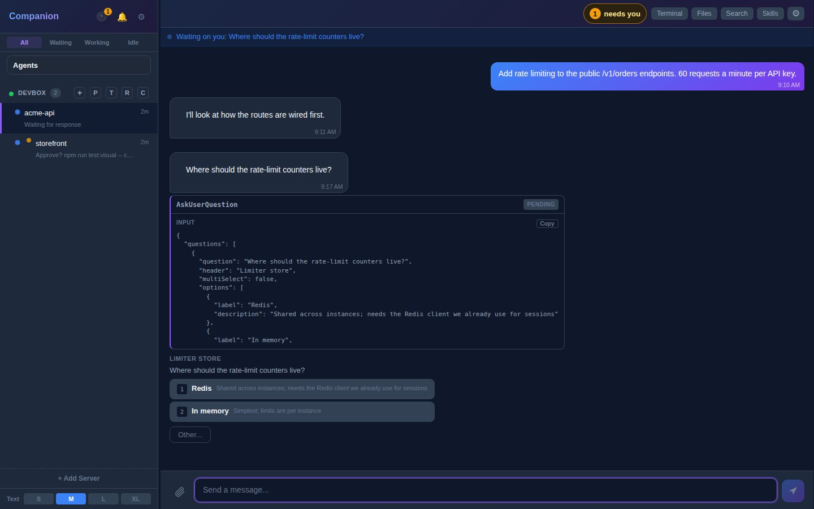
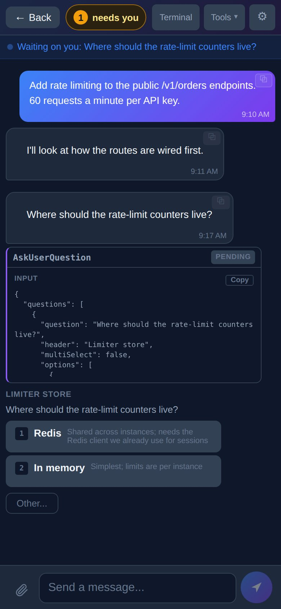
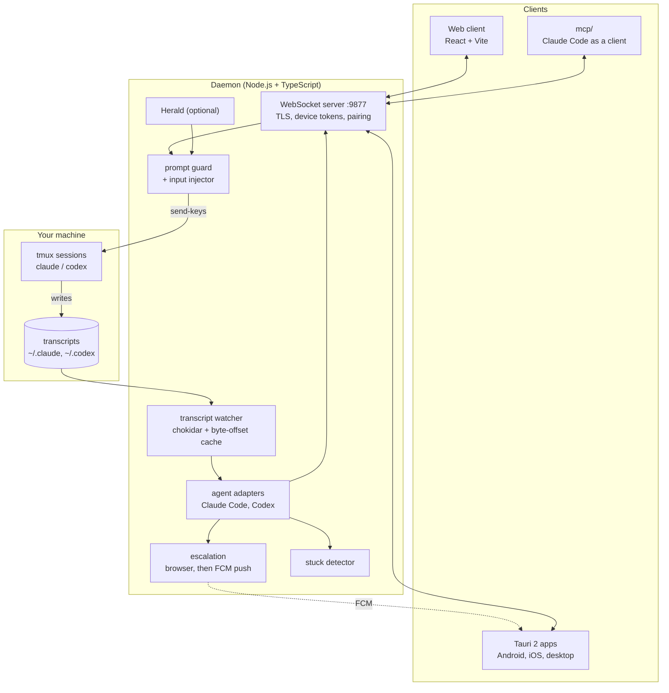

# Companion

[](LICENSE)

Watch and drive your Claude Code and Codex CLI sessions from a phone, a browser or a desktop app. A small daemon runs next to your coding agents in tmux, reads their transcripts as they are written, and tells you the moment one needs you: a question, a permission prompt, a failed turn, a session that looks stuck. You answer from wherever you are, and the answer is typed into the real terminal.



| On a phone | |
|---|---|
|  | The sidebar lists every session on every paired server with its state (waiting, working, idle). The open session is `acme-api`, paused on a pending `AskUserQuestion`; tapping **Redis** or **In memory** answers it in the terminal. `storefront` is waiting on a Bash approval.<br><br>*Rendered from the production web build against a sandboxed daemon with made-up sessions.* |

## What it does

- **One inbox for many sessions.** Every tmux session running Claude Code or Codex shows up with its state. Questions, plan approvals and tool permissions render as buttons; free text goes to the prompt.
- **Notifications that mean something.** Browser notifications first, then FCM push after a delay if you have not looked (two-tier escalation, quiet hours). A failed turn notifies only when the turn *ends* on an unresolved error, so red-then-green TDD stays quiet.
- **Stuck detection, no LLM.** Deterministic signals over the parsed transcript: the same failing test recurring, the same tool call with the same result, an edit undone and redone, no progress for 30 minutes, a hung tool call with an unchanged screen. See [docs/stuck-detection.md](docs/stuck-detection.md).
- **Code review per turn.** Edits are grouped by the turn that made them, with exact hunks, mark-reviewed and revert, for Claude and Codex alike.
- **Terminal, files and search.** A live terminal view, a file viewer and conversation search for each session ([docs/SESSION-CONTROLS.md](docs/SESSION-CONTROLS.md)).
- **Herald**, an optional conversational layer with local voice (TTS, STT, wake word) that can brief you on all sessions and act through the same guarded input paths ([docs/herald.md](docs/herald.md)).
- **Remote control for other agents.** `mcp/` exposes paired daemons to Claude Code as MCP tools (list sessions, read, send input, dispatch work), and `concierge/` is a routing session built on it.

## Platforms

- **Web**: React + Vite + TypeScript, served by the daemon at `http://<host>:9877/web/`.
- **Android, iOS, macOS, Linux, Windows**: the same web code wrapped with Tauri 2. The [latest release](https://github.com/Hexidecibel/companion/releases/latest) (v0.2.5) ships an Android APK, an iOS IPA, a macOS `.dmg` (Apple silicon), a Linux `.deb` and a Windows `setup.exe`.
- **Docker**: `ghcr.io/hexidecibel/companion`, built and smoke-tested by the [Docker workflow](.github/workflows/docker.yml).

## Architecture



```
daemon/     Node.js daemon: WebSocket API, transcript parsing, tmux control, pairing, push, stuck detection, Herald
web/        React + Vite client, also the UI of every Tauri app
desktop/    Tauri 2 shell for desktop and mobile builds
mcp/        @companion/mcp-remote: paired daemons as MCP tools
concierge/  a Claude session that routes requests to the right project over mcp-remote
voice/      Herald's local voice service (Python: TTS, STT, wake word)
triggers/   Herald remote triggers for macOS and Windows
docker/     image entrypoint and helpers
```

More detail, including the WebSocket protocol and the parser internals: [docs/ARCHITECTURE.md](docs/ARCHITECTURE.md).

## Engineering decisions

- **Read transcripts, do not scrape the screen.** The source of truth is the JSONL the CLI already writes. A cache keeps a byte offset per file and reads only what was appended, and it re-checks the bytes at the old tail so a rewritten file is detected instead of parsed as garbage. Terminal captures are used only for things that are not in the transcript, such as start-up trust prompts, and are rate-limited and deduplicated.
- **Never type over the user.** Before injecting input, the prompt guard reads Claude Code's prompt box. It refuses with a reason the client can show if the box holds a draft (`prompt_has_draft`), someone is typing in the terminal (`user_typing`), or a choice or trust prompt is on screen (`prompt_waiting`). Answering a choice re-checks that the same prompt is still up and verifies it went away.
- **Tie a tmux pane to the right transcript.** Several sessions can share a working directory. The daemon matches terminal content against recent transcript text first, then process IDs, then elimination, and persists the mapping across restarts.
- **One adapter per agent.** Claude Code and Codex differ in file layout, tool names and prompts. Each lives behind an adapter (`daemon/src/agents/`), and features such as review, stuck detection and notifications work over roles rather than tool names.
- **Pairing without shared secrets in chat.** A new device either types a 6-digit code shown on the server (2-minute expiry, 5 tries, per-IP backoff, refused from public networks by default), is approved from an already paired device, or scans a one-time QR (256-bit secret, 10 minutes, single use). Each device gets its own revocable token, stored as a salted SHA-256 hash and compared in constant time.
- **Cheap to leave running.** The systemd unit sets `UV_USE_IO_URING=0` because libuv's io_uring SQPOLL thread busy-polled about 12% of a core on an idle daemon, and runs at `Nice=5`.

## Quick start (Docker)

You need Docker with Compose v2 (Linux, or Docker Desktop on Mac and Windows).

```bash
git clone https://github.com/Hexidecibel/companion.git && cd companion
cp .env.example .env        # set COMPANION_PROJECTS=/path/to/your/code, and PUID/PGID (id -u / id -g)
docker compose up -d        # pulls ghcr.io/hexidecibel/companion
```

Open `http://localhost:9877/web/`, choose **Pair with a code** and type the code from `bin/docker pair-code` (or `docker compose logs companion`). The setup wizard does the rest; its **Claude Code** step can install Claude Code into the container, or run `docker compose run --rm companion setup-claude`. Sign in once with `docker compose exec companion claude`, then `/login`.

Optional extras: Herald's local voice (`docker compose --profile voice up -d`), a private HTTPS address on your tailnet (`--profile tailscale`), and host networking so phones find the server under Nearby (Linux). All of it is in [docs/docker.md](docs/docker.md).

## Quick start (on the host)

```bash
git clone https://github.com/Hexidecibel/companion.git
cd companion
bin/companion setup               # builds the daemon, writes ~/.companion/config.json, prints connection info
bin/companion start               # or: bin/companion autostart enable  (systemd / launchd)
```

Then:

1. Open `http://<your-server>:9877/web/`, or install an app from [Releases](https://github.com/Hexidecibel/companion/releases).
2. **Add server.** The apps list nearby servers (mDNS). Pick yours or type its address, then enter the 6-digit code the server shows (daemon log, `bin/companion pair`, or a device you already signed in on) or approve the new device from that other device. Remote setup: `bin/companion pair --qr` (or Settings > Devices > Show pairing QR) and scan it.
3. Create a new tmux session from the app or adopt an existing one.

See and revoke devices in Settings > Devices or with `bin/companion devices list|revoke|rename`. The single `token` in the config file still works as a legacy, all-powerful credential ("Enter token manually" in Add server); Settings > Devices offers "Upgrade to a device token" for apps still using it.

## Configuration

Config file: `~/.companion/config.json` (created by `bin/companion setup`).

| Option | Default | Description |
|--------|---------|-------------|
| `port` | 9877 | WebSocket server port |
| `token` | (generated) | Legacy server token (prefer paired device tokens) |
| `name` | "Companion on &lt;hostname&gt;" | Display name (mDNS, pairing) |
| `pairing` | true | Allow new devices to pair (code, approval, QR) |
| `pairing_allow_public` | false | Allow code pairing from outside LAN / tailnet / localhost |
| `tls` | true | Enable TLS |
| `tmux_session` | "claude" | Default tmux session name |
| `code_home` | "~/.claude" | CLI config directory |
| `mdns_enabled` | true | Enable Bonjour/mDNS discovery |
| `push_delay_ms` | 60000 | Delay before sending push notifications |

## Service management

```bash
bin/companion autostart enable    # install as a system service (systemd / launchd)
bin/companion autostart disable   # remove the system service
bin/companion start [-f]          # start the daemon (-f: foreground, for debugging)
bin/companion stop | restart      # stop, or restart via the service manager
bin/companion status              # running state, PID, sessions
bin/companion logs                # platform-aware log viewer
bin/companion config              # view / set config values
bin/companion pair [--qr]         # approve or deny pairing devices, or print a pairing QR
bin/companion devices             # paired devices: list | revoke | rename
```

To uninstall: `bin/companion autostart disable && rm -rf ~/.companion`.

## Tests and CI

```bash
cd daemon && npm test     # Jest: 1,990 tests in 121 suites
cd web && npm test        # Vitest: 136 test files
cd mcp && npm test        # 3 tests
```

The [CI workflow](.github/workflows/ci.yml) runs typecheck, lint, format check, tests (with Codecov coverage) and build for the daemon, and typecheck, tests and build for the web client, on every push and pull request to `main`. The [Docker workflow](.github/workflows/docker.yml) builds the image and smoke-tests it, and [release.yml](.github/workflows/release.yml) builds the daemon package and the Android, iOS and desktop Tauri apps for each `v*` tag. At the time of writing a handful of tests fail locally (3 daemon tests, 1 web test file) and the latest CI run on `main` is red on the daemon test step.

## Documentation

| Doc | Description |
|-----|-------------|
| [Docker](docs/docker.md) | Docker Compose: first run, volumes, upgrades, backups, Tailscale, voice |
| [Features](FEATURES.md) | Full feature catalog |
| [Session controls](docs/SESSION-CONTROLS.md) | Conversation viewer, file viewer, terminal, keyboard shortcuts |
| [Notifications](docs/NOTIFICATIONS.md) | Push notifications, escalation, quiet hours |
| [Architecture](docs/ARCHITECTURE.md) | System design, WebSocket protocol, parser internals |
| [Codex](docs/codex.md) | Codex CLI adapter and its parity with Claude Code |
| [Stuck detection](docs/stuck-detection.md) | Signals, thresholds and pane-capture rules |
| [Herald](docs/herald.md) | The conversational layer, voice and remote triggers |
| [Development](docs/DEVELOPMENT.md) | Building, testing, project structure, troubleshooting |
| [Changelog](CHANGELOG.md) | Release history |

## Privacy

Companion is self-hosted: no telemetry, no analytics, no third-party data sharing. Push notifications go through Firebase Cloud Messaging only if you enable push. See [PRIVACY.md](PRIVACY.md).

## License

MIT. See [LICENSE](LICENSE).
